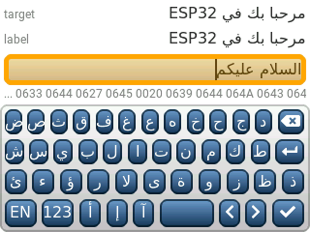

<div dir="rtl">

# تعريب إدخال النص العربي وعرضه في LVGL على ESP32

هذا المستودع نسخة من مكتبة الواجهات الرسومية LVGL عند الإصدار ٦.١.٢، وهو إصدار لا يشكّل الحروف العربية ولا يرتبها من اليمين إلى اليسار، فتظهر الكلمة العربية حروفًا منفصلة تُقرأ من اليسار إلى اليمين. أضفنا إلى المكتبة تطبيقًا لجهاز ESP32 فيه نص عربي وحقل إدخال ولوحة مفاتيح، ثم بنينا ثلاثة تصاميم تضيف دعم العربية، ووضعنا كل تصميم في فرع.

مشروع مقرر «تعريب الحاسبات» (٤٣٠ عال) في جامعة الملك سعود.

## الفروع

| الفرع | ما فيه | الفرق عن main |
|---|---|---|
| [main](https://github.com/Ibrahimoss/lvgl-arabic/tree/main) | التطبيق على المكتبة كما صدرت، دون دعم للعربية | |
| [design-a-double-buffer](https://github.com/Ibrahimoss/lvgl-arabic/tree/design-a-double-buffer) | التصميم أ، المخزنان المؤقتان: يحفظ الحقل الحروف كما كُتبت، ويبني منها بعد كل تعديل نسخة مشكّلة مرتبة للعرض. لا يغيّر شيئًا في المكتبة | [عرض الفرق](https://github.com/Ibrahimoss/lvgl-arabic/compare/main...design-a-double-buffer) |
| [design-b-shape-while-typing](https://github.com/Ibrahimoss/lvgl-arabic/tree/design-b-shape-while-typing) | التصميم ب، التشكيل عند الكتابة: يُشكَّل الحرف لحظة كتابته، ويحفظ الحقل ما تعرضه الشاشة كما كان يفعل ترمينال ٣٢٧٠ العربي. لا يغيّر شيئًا في المكتبة | [عرض الفرق](https://github.com/Ibrahimoss/lvgl-arabic/compare/main...design-b-shape-while-typing) |
| [design-c-shape-while-drawing](https://github.com/Ibrahimoss/lvgl-arabic/tree/design-c-shape-while-drawing) | التصميم ج، التشكيل عند الرسم: يحفظ الحقل الحروف كما كُتبت، وتشكّلها المكتبة لحظة رسم كل حرف. يعدّل أربعة ملفات من المكتبة ويضيف ملفًا جديدًا | [عرض الفرق](https://github.com/Ibrahimoss/lvgl-arabic/compare/main...design-c-shape-while-drawing) |

يبدأ كل فرع من فروع التصاميم من main ويضيف إليه تصميمه وحده.

## هذا الفرع: التصميم ج، التشكيل عند الرسم

يحفظ الحقل الحروف كما كُتبت، والمكتبة نفسها تشكّلها: في حلقة الرسم يأخذ كل حرف شكله من جاريه لحظة رسمه، وتعرف خوارزمية الاتجاه في المكتبة الحروفَ العربية فترتب السطر من اليمين إلى اليسار. ولذلك يعمل حقل النص والعناوين في المكتبة كما هي، ويقرأ البرنامج النص كما كُتب دون تحويل. والتعديل في ملفات المكتبة نفسها في المجلد `src`، وتعليقاته تبدأ بـ Patch C:

- شكل الحرف العربي من جاريه، في ملف جديد: `src/lv_misc/lv_txt_ar.c`
- التشكيل لحظة الرسم: `src/lv_draw/lv_draw_label.c`
- الحروف والأرقام العربية في خوارزمية الاتجاه: `src/lv_misc/lv_bidi.c`
- قياس الحرف بالشكل الذي يُرسم به: `src/lv_misc/lv_txt.c` و`src/lv_objx/lv_label.c`

ولوحة المفاتيح العربية في `esp32/components/arabic_input/arabic_kb.c`.

## الشاشة

من الأعلى: الجملة «مرحبا بك في ESP32» مشكّلة يدويًا كما يجب أن تظهر، ثم الجملة نفسها كما يعرضها الفرع، ثم حقل الإدخال، ثم رموز آخر الحروف التي يحفظها الحقل، ثم لوحة المفاتيح. ويطبع الترمينال رموز النص كاملًا بعد كل تعديل. وهذه شاشة هذا الفرع في المحاكي بعد كتابة «السلام عليكم»:



## البناء والتشغيل

يحتاج المشروع إلى ESP-IDF، وقد جرّبناه على الإصدار ٦.١. التطبيق في المجلد `esp32`، ومكتبة LVGL هي هذا المستودع نفسه.

على محاكي QEMU من Espressif:

</div>

```
cd esp32
idf.py build
idf.py qemu --graphics monitor
```

<div dir="rtl">

تفتح نافذة فيها شاشة الجهاز، ويصبح الترمينال لوحة مفاتيح له: ما يُكتب فيه يصل إلى حقل الإدخال، والحروف العربية تصل حين تكون لغة لوحة المفاتيح عربية. ينقل Tab التركيز إلى لوحة المفاتيح التي على الشاشة، ويُغلق Ctrl+] المحاكي.

على لوحة ESP32-2432S028R، حيث PORT منفذ اللوحة (مثل COM5):

</div>

```
cd esp32
idf.py -B build_cyd -D SDKCONFIG=sdkconfig.cyd -D "SDKCONFIG_DEFAULTS=sdkconfig.defaults;sdkconfig.cyd.defaults" -p PORT flash monitor
```

<div dir="rtl">

## ملاحظات

- ملف التعريف الأصلي للمكتبة في [README_LVGL.md](README_LVGL.md).
- الخط العربي في التطبيق مولَّد من خط DejaVu Sans وأيقونات Font Awesome بأداة lv_font_conv.
- أضافت LVGL تشكيل الحروف العربية بنفسها ابتداءً من الإصدار ٧.٠.

</div>
